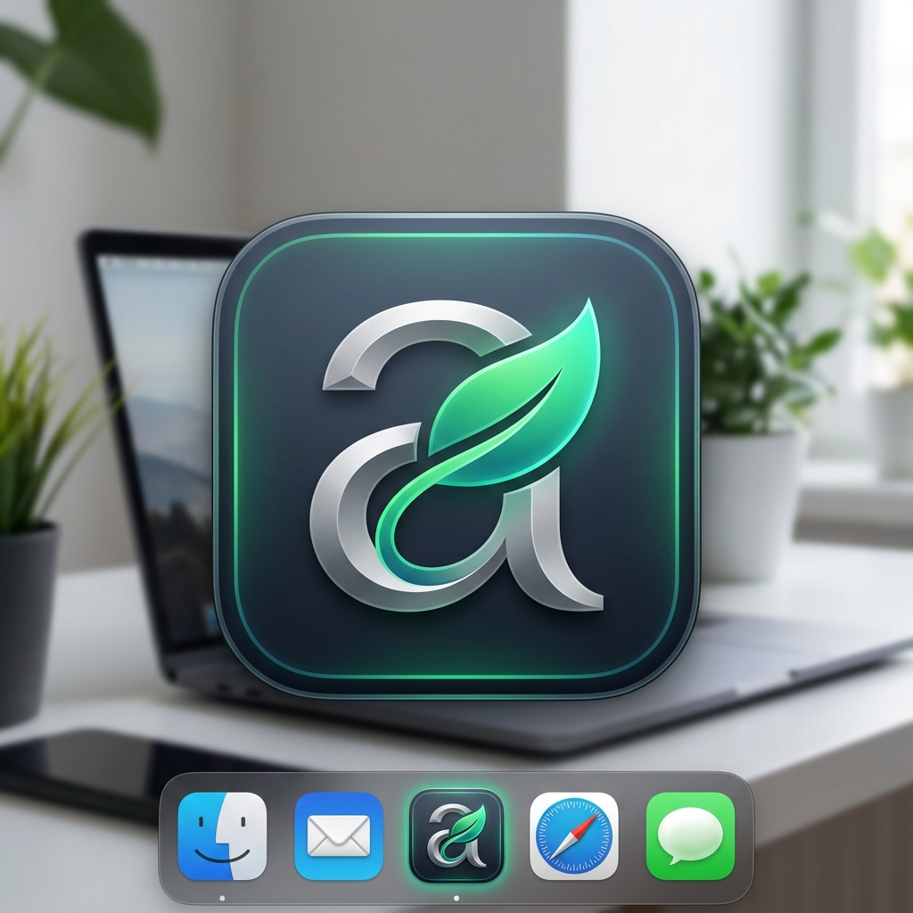

<p align="center">
  
</p>

<h1 align="center">AntiBox</h1>

<p align="center">
  <strong>Native macOS Menu Bar Quota Monitor & Smart Usage Advisor for AI Services</strong><br />
  A lightweight, privacy-focused utility built with SwiftUI for tracking Google Gemini and Anthropic Claude rate limits and token allocations.
</p>

<p align="center">
  
  
  
  
  
</p>

---

## Overview

Modern developers frequently juggle multiple AI provider accounts and model tiers to optimize latency, cost, and availability. Checking remaining quotas across multiple developer consoles or internal proxies often disrupts workflow.

**AntiBox** lives unobtrusively in your macOS menu bar as a high-density, read-only monitoring dashboard. It surfaces exact remaining token percentages, precise countdown timers until cycle resets, and algorithmic pacing recommendations to prevent unexpected rate-limit exhaustion.

---

## Core Capabilities

### 1. Terminal-Precision Model Indicators
- **High-Density Indicator Rows**: Visualized in continuous rounded pill cards inspired by macOS developer utilities.
- **Accurate Model Metrics**: Tracks individual model allocations (e.g. `gemini-3.1-pro-high`, `gemini-3.1-flash-image`, `claude-sonnet-4-6`).
- **Live Cycle Countdown**: Dynamic reset countdowns (`🕒 4h 59m`, `🕒 2d 16h`) displayed in warm amber typography.
- **Color-Coded Statuses**:
  - **Healthy (Emerald)**: Muted dark green container (`#142924`) with mint percentages for sufficient quota.
  - **Critical / Depleted (Ruby)**: Crimson container (`#2e141a`) with alert triangle (`⚠️`) and custom flags (e.g. `Weekly 0%`).

### 2. Multi-Account Switching
- Effortlessly toggle between configured billing accounts and proxy pools (e.g. `tunefix.id@gmail.com`, `xtampol@gmail.com`, `yraunajfni@gmail.com`) via a native capsule menu dropdown.

### 3. Smart AI Budget Advisor
- **Algorithmic Consumption Pacing**: Analyzes aggregate token capacity against the earliest cycle reset horizon:
  $$\text{Daily Safe Limit} = \frac{\sum \text{Remaining Tokens}}{\max(\text{Days Until Reset}, 1)}$$
- **Burn-Rate Classification**: Categorizes system burn into *Sustainable*, *Elevated*, or *High Depletion Risk*.

### 4. Zero Plain-Text Credentials (Apple Keychain)
- All API tokens and credentials are encrypted and stored directly in macOS Keychain Services via `kSecClassGenericPassword` under service `com.antibox.credentials`.
- No sensitive tokens are ever stored in `UserDefaults` or plaintext config files.

### 5. Native Desktop Notifications
- Configured with `UNUserNotificationCenter` to dispatch alerts when any account's quota drops below critical threshold ($\le 15\%$).
- Built-in debounce mechanism prevents repetitive alerts on subsequent background sync cycles.

### 6. SwiftData Usage History
- Includes a SwiftData persistent model (`DailyUsageLog`) for tracking daily token consumption over time.

---

## Architecture & Project Structure

```
AntiBox/
├── Package.swift                             # Swift Package Manager specification
├── Info.plist                                # LSUIElement=true (accessory menu bar app)
├── Assets/
│   └── logo.png                              # AntiBox App Icon
├── scripts/
│   └── build_app.sh                          # Native .app bundle packager
├── Sources/
│   ├── AntiBoxApp.swift                      # App entry point with MenuBarExtra (.window style)
│   ├── Models/
│   │   ├── AIProvider.swift                  # Provider enumerations (Gemini, Claude)
│   │   ├── Account.swift                     # Account metadata and pool aggregations
│   │   ├── QuotaItem.swift                   # Model-level quota items and countdown logic
│   │   ├── UsageRecord.swift                 # SwiftData historical logging entity
│   │   └── BudgetRecommendation.swift        # Advisor output recommendations
│   ├── Storage/
│   │   └── KeychainManager.swift             # Thread-safe Security.framework wrapper
│   ├── Services/
│   │   ├── QuotaServiceProtocol.swift        # Protocol interface for read-only quota clients
│   │   ├── GeminiQuotaService.swift          # Google Gemini quota fetching client
│   │   ├── ClaudeQuotaService.swift          # Anthropic Claude quota fetching client
│   │   ├── SmartBudgetAdvisor.swift          # Budget smoothing engine
│   │   └── NotificationManager.swift         # UNUserNotificationCenter alert manager
│   ├── ViewModels/
│   │   └── DashboardViewModel.swift          # Reactive state coordinator and account switcher
│   └── Views/
│       ├── MenuBarView.swift                 # Popover window with .ultraThinMaterial
│       ├── Components/
│       │   ├── ModelQuotaRowView.swift       # Apple HIG terminal indicator row
│       │   ├── BudgetAdvisorCardView.swift   # Compact smart advisor banner
│       │   └── QuotaGaugeView.swift          # Dynamic linear health progress bar
│       └── Sheets/
│           └── AddAccountSheet.swift         # Account connection modal
└── Tests/
    └── AntiBoxTests/
        └── SmartBudgetAdvisorTests.swift     # Test suite verifying algorithmic calculations
```

---

## Getting Started

### Prerequisites
- macOS 14.0 (Sonoma) or newer
- Swift 5.9+ or Xcode 15+

### Build & Run

#### Option 1: Native Application Bundle (Recommended)
Compile and package AntiBox into a self-contained `.app` that lives purely in your Menu Bar without dock clutter:
```bash
# Clone the repository
git clone https://github.com/naenmad/AntiBox.git
cd AntiBox

# Build the release .app bundle
./scripts/build_app.sh

# Launch the app
open AntiBox.app
```

#### Option 2: Swift CLI (Debug Mode)
```bash
swift run AntiBox
```

#### Option 3: Xcode
```bash
xed .
```
Press **⌘R** to build and run.

---

## Keyboard Shortcuts

| Shortcut | Action |
| :--- | :--- |
| `⌘R` | Refresh all account and model quotas |
| `⌘N` | Open modal to connect a new account |
| `⌘Q` | Quit AntiBox |

---

## Running Tests

AntiBox includes a test suite verifying budget algorithms, threshold classifications, and depletion handling:
```bash
swift test
```

---

## License

This project is open-source and available under the [MIT License](LICENSE).
