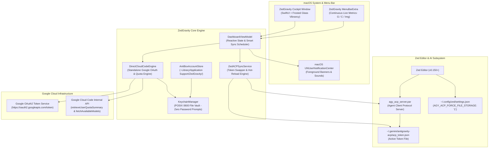
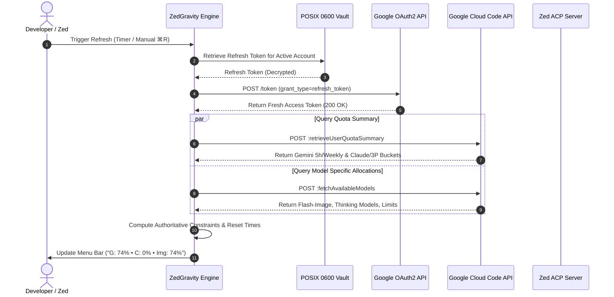
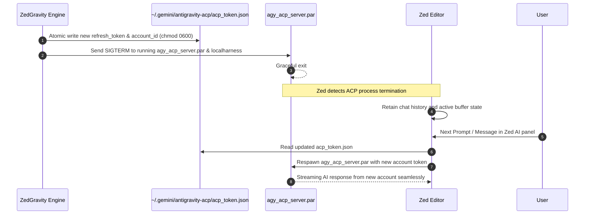

# ZedGravity Architecture & Design Specification

ZedGravity is an independent, native macOS companion application engineered specifically for **Zed Editor** and **Google Antigravity Agent Client Protocol (ACP)**. It provides real-time multi-account quota monitoring, zero-prompt credential vaulting, and seamless hot-swapping between Google Gemini, Claude Opus/Sonnet, and GPT-OSS models.

---

## 1. System Topology

---

## 2. Token Refresh & Quota Discovery Flow

Unlike traditional proxy servers that require a daemon running on `localhost:8080`, ZedGravity communicates **directly and natively** with Google Cloud Code APIs using official Google OAuth client metadata:

---

## 3. Zero-Downtime Zed ACP Hot-Reload Mechanism

When ZedGravity switches accounts (either manually or via Intelligent Auto-Switch), it swaps credentials without interrupting Zed's open editor windows or wiping active chat threads:

---

## 4. Quota Monitoring & Auto-Switch Strategy

ZedGravity provides a configurable strategy engine:

| Strategy Mode | Trigger Condition | Candidate Selection |
| :--- | :--- | :--- |
| **Claude / GPT Only** | Lowest 3P model quota $\le 5\%$ | Highest available Claude quota ($> 5\%$) |
| **Gemini Only** | Gemini remaining quota $\le 5\%$ | Highest available Gemini quota ($> 5\%$) |
| **Both (Dual Guard)** | Either Gemini or Claude $\le 5\%$ | Highest overall capacity where both $> 5\%$ |

---

## 5. Security & Isolation

1. **Zero Prompt Credential Vaulting**: Tokens are stored in private Application Support folders with strict POSIX `0600` permissions, eliminating repetitive macOS Keychain password dialogs.
2. **Zero Network Telemetry**: ZedGravity never makes calls to analytics, tracking servers, or remote third-party relays. All network communication is strictly between your machine and `googleapis.com`.
3. **No Root Privileges**: Operates completely in user-space without background root daemons or `launchd` system agents.
